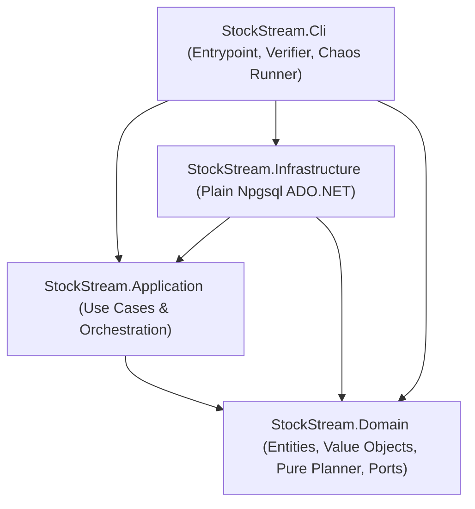

# DESIGN.md — StockStream Backlog Sync Processor (.NET 8 / C# DDD Edition)

## 1. Domain-Driven Design (DDD), SOLID & DRY Architecture

This solution is structured as a layered **Clean / Onion Architecture** in .NET 8 (C# 12) where dependencies point strictly inward toward `StockStream.Domain`:

### How DDD Principles Are Applied
- **Ubiquitous Language**: Types in `StockStream.Domain` mirror the business domain verbatim: `StoreIdentity`, `QueuedUpdate`, `ReceiptAvailability`, `UpdateKind` (`Snapshot` vs. `Delta`), `SkippedUpdate`, `SkipReason`, `StoreStreamSnapshot`, and `SyncDecision`.
- **Rich, Pure Domain Service (`StoreStreamPlanner`)**: Every rule governing sequence ordering, duplicate collapsing, conflicting `message_id` detection, receipt readiness barriers, skip-to-snapshot poison recovery, and sequence gap timeouts is encapsulated in a **pure, stateless, zero-I/O** domain service (`StoreStreamPlanner.PlanNext`).
- **Discriminated-Union Domain Decisions (`SyncDecision`)**: Modeled as a closed C# record hierarchy (`ApplyUpdateDecision`, `WaitForReceiptDecision`, `WaitForMissingSequenceDecision`, `BlockStoreDecision`, `StoreDrainedDecision`) so application services handle every state transition exhaustively via pattern matching.

### How SOLID Principles Are Applied
- **Single Responsibility Principle (SRP)**:
  - `StoreStreamPlanner` *only* computes the next domain decision for a store's stream view.
  - `StoreBacklogAdvancer` *only* advances a single claimed store stream up to `MaxAppliesPerClaim`.
  - `WorkerEngine` *only* manages the worker's poll, lease acquisition, advancement, and clean drain lifecycle.
  - `FleetSupervisor` *only* spawns, monitors, and restarts the 4 OS worker processes.
  - `PostgresAdvisoryLeaseManager` *only* acquires/releases session advisory locks.
  - `PostgresStoreSyncRepository` *only* executes transactional SQL against PostgreSQL.
- **Open/Closed Principle (OCP)**:
  - Domain decisions (`SyncDecision`) and port interfaces (`IStoreSyncRepository`, `IStoreLeaseManager`, `IStoreStreamPlanner`) allow extending storage engines, locking mechanisms, or logging sinks without modifying application orchestration.
- **Liskov Substitution Principle (LSP)**:
  - `PostgresStoreSyncRepository` and `InMemoryFakeStoreSyncRepository` (in `StockStream.Tests`) adhere to the exact same transactional CAS and idempotency contracts defined on `IStoreSyncRepository`.
- **Interface Segregation Principle (ISP)**:
  - Infrastructure responsibilities are split into narrow, role-specific interfaces (`IStoreLeaseManager`, `ISchemaMigrator`, `IStoreSyncRepository`, `ISyncLogger`) so consumers only depend on the methods they invoke.
- **Dependency Inversion Principle (DIP)**:
  - `StockStream.Domain` and `StockStream.Application` have **zero NuGet dependencies** (and zero reference to `Npgsql`). All database and OS details are injected from outer layers.

### How DRY Is Applied
- **Build Configuration (`Directory.Build.props`)**: Centralizes `net8.0`, `Nullable`, `ImplicitUsings`, and `TreatWarningsAsErrors` across all 5 projects.
- **Canonical Enum & Fingerprint Mappings**: Database string representations (`DomainEnumMappings`) and the SQL store fingerprint expression (`FingerprintSqlExpression`) are defined in one place.
- **Unified Executable (`StockStream.Cli`)**: One binary provides `supervisor` (default), `worker`, `verify`, and `chaos` modes — eliminating duplicate bootstrapping code and enabling `FleetSupervisor` to spawn worker OS processes directly from `Environment.ProcessPath`.

---

## 2. Risk Register — What Can Go Wrong & Where Each Risk Was Found

| # | Risk / Failure Mode | Where Found | Impact if Unhandled | How We Defend Against It |
|---|---|---|---|---|
| **R1** | **Duplicate queue rows** (~5% of updates appear twice with different `queue_messages.id` but identical `message_id`, `seq`, and `receipt_id`) | Spec (*"Gateways retransmit an update until acknowledged"*) & `seed.js` (`DUP_RATE = 0.05`) | Double-applying a delta or double-incrementing `version`; double-charging the chain in `apply_log` | Three layers: (1) `StoreStreamPlanner.CollapseDuplicates` collapses rows by `seq` (earliest `id` wins); (2) `store_stock.last_seq` advances past `seq` on first apply; (3) DB `UNIQUE` indexes on `apply_log(message_id)` and `apply_log(chain_id, store_id, seq)`. |
| **R2** | **Out-of-order arrival** (`queue_messages.id` arrival order is randomly shuffled relative to `seq`) | Spec (*"arrive interleaved... in whatever order the network delivers them"*) & `seed.js` (`shuffle(rows)`) | Applying a delta before its base snapshot or out of `seq` order corrupts `store_stock.stock` | `StoreStreamPlanner` orders outstanding rows per store by `seq ASC` and only ever considers `cursor = LastSeq + 1` (unless recovering via a snapshot after a loss). |
| **R3** | **Mid-stream re-snapshots** (~25% of stores emit a second `snapshot` at `seq ∈ [10, n-5]` after gateway reboot) | Spec (*"A gateway that restarts... begins with a fresh snapshot"*) & `seed.js` (`RESNAPSHOT_PROB = 0.25`) | Merging a snapshot instead of replacing `stock` leaves stale delisted SKUs on the shelf | Snapshot branch in `PostgresStoreSyncRepository.ApplyUpdateAsync` replaces `stock` wholesale with `q.payload -> 'stock'` while incrementing `version = s.version + 1`. |
| **R4** | **Delayed receipt uploads** (~12% of receipts have `ready_at` 3–25s in the future relative to seed time) | Spec (*"Uploads take time... compliance policy"*) & `seed.js` (`DELAY_RATE = 0.12`, `DELAY_MIN_S = 3`, `DELAY_MAX_S = 25`) | Prematurely applying an update before `ready_at <= now()` violates compliance; sleeping while holding a store lock blocks other stores | When `cursor` has `ready_at > now()`, `StoreBacklogAdvancer` records `not_before = ready_at` in `sync_store_state`, **releases the store advisory lock immediately**, and the worker moves on to other stores. |
| **R5** | **Permanently failed receipts ("poison" updates)** (`ready_at IS NULL` for a message at `5 < seq < 30`) | Spec (*"occasionally a gateway reports that an upload failed for good"*) & `seed.js` (`--poison` flag) | Applying it violates compliance; naively skipping a poisoned delta and applying `seq + 1` produces wrong stock; retrying forever hangs completion | **Skip-to-Snapshot Recovery**: when `seq = K` has `ready_at IS NULL`, all deltas `K .. M-1` depend on `K` and cannot be applied. If a later `snapshot` exists at `seq = M > K`, `StoreStreamPlanner` jumps straight to `M` (since a snapshot is a full state replacement) and logs `K .. M-1` in `skipped_updates`. If no later snapshot exists, the store is marked `blocked` at `last_seq` so the remaining 23 stores complete and the run exits `0`. |
| **R6** | **Base `schema.sql` has no uniqueness constraints on `apply_log`** | Inspecting `schema.sql` (`apply_log` only has `apply_pos BIGSERIAL PRIMARY KEY`) | Application bug or race condition could insert duplicate audit records | `PostgresSchemaMigrator` adds `CREATE UNIQUE INDEX apply_log_message_id_uniq ON apply_log(message_id)` and `CREATE UNIQUE INDEX apply_log_store_seq_uniq ON apply_log(chain_id, store_id, seq)`. |
| **R7** | **Two workers concurrently processing the same store** | Spec (*"4 worker OS processes... Postgres is the only channel"*) | Lost updates on `store_stock.stock` JSONB, out-of-order `apply_log` entries | **Defense in depth**: (1) Per-store session advisory lock `pg_try_advisory_lock(hashtextextended(@key, 0))` prevents contention; (2) `SELECT ... FOR UPDATE` + Compare-And-Set (`WHERE s.last_seq = @expectedLastSeq`) inside `ApplyUpdateAsync` guarantees safety even if advisory locks were bypassed. |
| **R8** | **Worker killed (`SIGKILL` / `Process.Kill` / OOM) mid-transaction or while holding a lock** | Spec (*"Worker processes get OOM-killed, redeployed, and restarted mid-run"*) | Partial state (stock updated without `apply_log` or vice-versa); stale lock permanently wedging a store | (1) `store_stock` + `apply_log` + `skipped_updates` writes execute in a single `NpgsqlTransaction` (automatic rollback on disconnect); (2) `PostgresSession` disables connection pooling (`Pooling = false`) so each worker owns one dedicated TCP session whose advisory locks are released by PostgreSQL the instant the process dies; (3) `FleetSupervisor` detects abnormal exit and respawns the worker slot. |
| **R9** | **Stale auxiliary state surviving `node seed.js` re-runs** | Inspecting `seed.js` line 124 (`TRUNCATE queue_messages, apply_log, store_stock, receipt_files RESTART IDENTITY CASCADE`) | Because `seed.js` is deterministic per `SEED`, re-running `node seed.js` produces the **exact same** `chain_id` and `store_id` UUIDs. Custom tables without a foreign key to the truncated tables survive across runs! | Three defenses: (1) `skipped_updates.queue_row_id` has `REFERENCES queue_messages(id) ON DELETE CASCADE`, so `seed.js` wipes it automatically; (2) `FleetSupervisor` truncates `sync_store_state` on startup; (3) `FingerprintSqlExpression` includes `max(q.enqueued_at)`. |
| **R10** | **Clock skew between .NET host and PostgreSQL container** | Reasoning about distributed timing | Worker thinks `DateTimeOffset.UtcNow >= ready_at` while PG `now() < ready_at` | All `ready_at` readiness checks and `NowEpochMs` calculations use PostgreSQL's `now()` inside a `REPEATABLE READ READ ONLY` transaction (`LoadStoreViewAsync`) and re-verify `r.ready_at <= now()` inside the write transaction (`ApplyUpdateAsync`). |
| **R11** | **Delta key appearing in both `set` and `unset` in the same payload** | Inspecting `seed.js` `deltaPayload()` | Ambiguous shelf state if worker and verifier disagree on precedence | Standardized precedence in both PostgreSQL (`(s.stock || set) - unset`) and `GroundTruthVerifier`: `set` is applied first, then `unset` removes delisted keys. |
| **R12** | **Conflicting `message_id`s at the same `(chain_id, store_id, seq)`** | Reasoning about buggy POS gateways | Non-deterministic state depending on query ordering | `StoreStreamPlanner.CollapseDuplicates` sorts by `QueueRowId ASC` (earliest arrival wins), emits a `StreamAnomaly`, and ignores conflicting late arrivals. |
| **R13** | **Missing sequence number (gap where `seq = K` has not arrived but `seq > K` exists)** | Reasoning about out-of-order network buffering | Applying `seq > K` immediately corrupts state; waiting forever blocks the store if `K` was permanently lost | Planner enters `WaitForMissingSequenceDecision` and persists `gap_since` in `sync_store_state`. If `K` does not arrive within `GapTimeoutMs` (60s), `K` is treated as lost and recovers via the next snapshot (or marks the store `blocked`). |

---

## 3. Alternatives Considered and Rejected

1. **Message-Level `SELECT ... FOR UPDATE SKIP LOCKED` on `queue_messages`**:
   *Rejected* because updates within a store have a strict causal dependency (`seq = 1, 2, 3, ...`). Locking individual messages across 4 workers causes workers to grab `seq = K+1` while `seq = K` is still in flight or delayed. Partitioning ownership **by store** (`24 stores / 4 workers = 6 stores per worker`) eliminates intra-store contention while maximizing inter-store parallelism.
2. **Row-Based Lease Table (`locked_by`, `lease_expires_at`) Instead of Session Advisory Locks**:
   *Rejected* because if a worker is OOM-killed or `SIGKILL`ed, its lease row remains locked until the TTL expires (stalling the store for 10–30s), and choosing a short TTL risks split-brain if a worker pauses. PostgreSQL session advisory locks (`pg_try_advisory_lock`) on an unpooled `NpgsqlConnection` release in 0ms on TCP disconnect, and our row-level `FOR UPDATE` + `last_seq` CAS provides hardware-grade safety underneath.
3. **Using Entity Framework Core or Dapper**:
   *Rejected* per the operational constraint (*"Talk to Postgres with a plain driver... and no ORMs"*). Using `NpgsqlConnection`, `NpgsqlCommand`, and `NpgsqlTransaction` directly also gives us explicit control over `IsolationLevel.RepeatableRead`, `SET TRANSACTION READ ONLY`, `FOR UPDATE` row locks, and server-side JSONB operators (`||` and `- text[]`).

---

## 4. How We Convinced Ourselves It Works

1. **xUnit Domain & Application Test Suite (`dotnet test` — `tests/StockStream.Tests`)**:
   12 fast unit tests covering `StoreStreamPlanner` and `StoreBacklogAdvancer` across out-of-order arrival, duplicate collapsing, conflicting `message_id` anomalies, pending-receipt barriers, poison skip-to-snapshot recovery, chained poisoned snapshots, permanently blocked stores, sequence gap timeouts, and base-less deltas.
2. **Ground-Truth Post-Run Verifier (`dotnet run --project src/StockStream.Cli -- verify`)**:
   `GroundTruthVerifier` connects to PostgreSQL after a run, reads the raw `queue_messages` and `receipt_files` tables, replays every store's stream from scratch in C#, and checks 7 hard invariants:
   - Zero duplicate `message_id`s in `apply_log`
   - Zero duplicate `(chain_id, store_id, seq)` pairs in `apply_log`
   - Zero compliance violations (`ready_at IS NOT NULL AND ready_at <= applied_at` for every logged update)
   - Strict per-store monotonicity of `seq` ordered by `apply_log.apply_pos`
   - Exact JSON shelf match between `store_stock.stock` and the C# reference replay
   - Exact match of `store_stock.version` and `store_stock.last_seq` against `apply_log`
   - Exact match of `skipped_updates` against expected skipped/blocked sequence numbers
3. **Automated Hostile Chaos Suite (`dotnet run --project src/StockStream.Cli -- chaos`)**:
   `ChaosSuiteRunner` automatically runs:
   - **Scenario 1**: `node seed.js --poison` (`SEED=42`), launches the 4-worker .NET fleet with `CHAOS_CRASH_PROB=0.015` (workers randomly call `Process.GetCurrentProcess().Kill()` inside `ApplyUpdateAsync` **after** writing `store_stock` and **before** inserting `apply_log` / committing), kills the entire supervisor + worker process tree mid-run after 2.5s, restarts the supervisor to finish draining, and verifies 0 violations via `GroundTruthVerifier`.
   - **Scenario 2**: Re-seeds with `SEED=1337`, poisons `seq = 2` on a store that has a later mid-stream snapshot, runs the .NET fleet to completion, and verifies skip-to-snapshot recovery (`skipped_updates` + post-snapshot `store_stock`) with 0 violations.

---

## 5. Known Rough Edges & Production Evolution

1. **Bounded Adaptive Polling (`≤ 400 ms`) Instead of `LISTEN/NOTIFY`**:
   Workers compute the earliest future `not_before = ready_at` timestamp against PostgreSQL's `now()` and sleep `Math.Clamp(notBefore - now, 50, 400)` ms. Because delayed receipts in `seed.js` mature purely by wall-clock time passing rather than an `UPDATE` statement firing a trigger, timer-based wakeup is required for `ready_at` maturation. In production, we would combine this timer with `LISTEN/NOTIFY` on `queue_messages` `INSERT`s.
2. **Unbounded Outstanding Row Fetch per Store Claim**:
   `LoadStoreViewAsync` reads all rows with `seq > last_seq` for the claimed store (40–110 rows in the seed). If a single store buffered 100,000 updates offline, we would paginate `WHERE seq > @lastSeq ORDER BY seq ASC LIMIT 500` and issue a targeted `WHERE seq > @lostSeq AND kind = 'snapshot' ORDER BY seq ASC LIMIT 1` query when recovering from a poison message.
